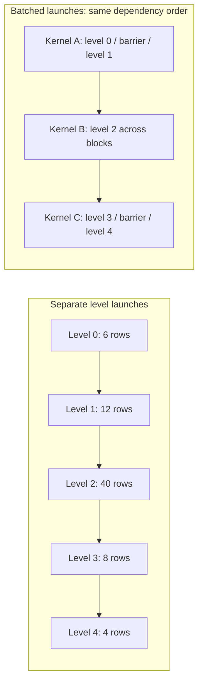

# Device level-set ILU0 regression tests

ILU type 60 supports CUDA/HIP device execution, zero fill, direct triangular
solves, and noniterative setup. CPU and SYCL execution are unsupported.
See the ILU user manual for the structural and pivot requirements.

Build with `HYPRE_BUILD_TESTS=ON`, then run from the CMake build directory:

```sh
cmake --build . --target test_ilu60
ctest --output-on-failure -R '^test_ilu60($|_)'
```

`test_ilu60` compares factors and corrections against an independent host
ILU0 oracle, exercises identity/RCM ordering, asymmetric and unsorted patterns,
invalid input and pivots, and repeated setup/destruction. `test_ilu60_stream`
checks stream/RHS changes, graph cache reuse, and cleanup. `test_ilu60_mpi`
uses three ranks to cover an empty rank, collective failure agreement, and
successful recovery after a rank-local failed setup. Stream tests require a
CUDA/HIP build; the MPI test additionally requires an MPI build and launcher.
Tests run serially to avoid competing GPU work. Exit status 77 means a skipped
test, including unavailable CUDA/HIP hardware; it is not correctness evidence.

The equivalent direct invocations, from the build's test directory, are:

```sh
./test_ilu60
./test_ilu60 --stream
mpirun -np 3 ./test_ilu60 --mpi
```

For the Makefile workflow, `make test_ilu60` (or `make tests`) builds the driver;
run the direct commands above to execute it. Exit status 77 indicates a
skip in this workflow as well. Select hardware supported by the build's
GPU architecture; a visible GPU alone does not guarantee compatibility.

Allocation accounting requires a separate build with
`HYPRE_ENABLE_MEMORY_TRACKER=ON`. The default test then checks live allocation
counts across repeated setups and destruction; without the tracker it reports
that accounting remains pending. Keep tracker overhead out of timing builds.
Debug builds exercise uncaptured graph fallback as well as numerical checks.
Passing these tests does not replace device memory/race sanitizer validation.

# Performance comparison protocol

Compare complete converged solves against both the original implementation
and type 0. Preserve the original library and executables before applying the
repair; build the compared executables with matching compiler, precision,
architecture, MPI, allocator, and profiling settings. Use an uninstrumented
Release build for timing, and run correctness tests separately.

The reference measurement used double precision, HIP Release, a Radeon PRO
W7900 (`gfx1100`), and one MPI rank. The companion hypredrive Laplacian driver
used BiCGSTAB, a seven-point stencil, device execution, RCM, and ILU0, with the
same solver options for all three configurations. Each process performed five
complete setup/solve repetitions. Two batches reversed configuration order:
original60/repaired60/type0, then type0/repaired60/original60. Repetition zero
from each process was retained separately and excluded from means; the means
use all eight remaining repetitions. Independent `b-Ax` residuals were computed
outside the solve timer. Profiling configuration was
`CALI_CONFIG=runtime-report,calc.inclusive` for every executable.

For each corresponding hypredrive executable and YAML configuration, the
primary workload command was:

```sh
CALI_CONFIG=runtime-report,calc.inclusive mpirun -np 1 ./laplacian \
    -i laplacian-ilu60.yml -n 112 112 112 -s 7 -ns 5
```

Use the original executable with its preserved type-60 library for original60;
use the repaired executable with `laplacian-ilu0.yml` for type0. Record raw
repetitions, first-use costs, per-batch means, standard deviations, iteration
counts, independent residuals, build settings, and binary/source hashes.
The measured configuration files and raw logs should accompany a performance
claim; this command alone does not specify every default of the driver.

Post-merge measurement at code revision `5cba6db83`, based on local master
`ed2fd68fc`, compared with preserved original type 60 `a9a763208`. The companion
result set is `v1-correctness-20261006-125018`. Values below are milliseconds,
112 cubed; every retained solve took 70 iterations.

| Configuration | Setup mean ± SD | Solve mean ± SD | Combined mean ± SD | Maximum relative residual |
| --- | ---: | ---: | ---: | ---: |
| Original type 60 | 33.698 ± 0.393 | 555.791 ± 0.415 | 589.489 ± 0.531 | 7.90e-07 |
| Repaired type 60 | 63.910 ± 0.711 | 556.502 ± 0.493 | 620.412 ± 0.578 | 7.90e-07 |
| Type 0 | 17.771 ± 0.101 | 685.395 ± 0.523 | 703.166 ± 0.508 | 4.74e-07 |

First setup/solve costs, batches 1 and 2 (milliseconds):

- Original type 60: 191.165/555.397; 191.693/555.789.
- Repaired type 60: 225.659/555.595; 237.551/556.345.
- Type 0: 84.439/725.779; 82.579/725.545.

The repaired solve is 0.128% slower than original type 60 and 18.806% faster
than type 0. Combined time is 5.246% above original and 11.769% below type 0.
The primary solve-time target is preserved, but setup/total-cost preservation
is unmet. The added validation runs at setup; no claim is made that the
remaining overhead is the minimum achievable cost. The original implementation
fails the independent asymmetric-pattern regression, so its timing does not
establish correctness.

These results are workload-specific: type 0 is faster on the measured 64-cubed
Laplacian and elasticity case. Extra reversed elasticity batches reproduced
order sensitivity in original type 60 (~1245 versus ~1320 ms), while repaired
solve stayed ~1243-1247 ms. Its cause was not isolated; do not infer an
unconditional repair speedup from pooled elasticity means. Attach raw data and
source/build provenance when using these data in a PR. CUDA compilation and
CPU rejection tests passed; CUDA runtime tests skipped without a usable GPU.
SYCL compilation and device sanitizer validation remain unverified.

# Level-set ILU0 optimization follow-up (2026-10-06)

This comparison starts from the correctness-repaired implementation `cf2d724b8`
(equivalent code to `5cba6db83`), rather than the defective original `a9a763208`
used in the historical repair comparison above. The current candidate is recorded
by source diffs and binary/library hashes in the companion workspace's
`testing/ilu0-optimization/candidate4/`, `candidate4-full/`, and
`candidate4-data/` directories. The preserved baseline library and executables
are in `testing/ilu0-optimization/baseline/`.

## Main optimization: share the work within a row

The largest improvements come from **cooperative processing of long rows** in
both numeric factorization and triangular solves. The baseline already exposed
parallelism between independent rows in a dependency level, but assigned each
row to one GPU thread. That thread performed all sparse entry work serially.
When levels contain few rows, or rows contain many entries, this leaves little
work for other lanes to do. The optimized implementation exposes a second source
of parallelism: independent work on entries within the same row.

A dependency level contains rows whose required predecessor rows have already
finished. Rows in that level may execute concurrently; a later level must wait
for its predecessors. These dependency levels are retained. The optimization
changes how threads process a row and how level boundaries are implemented.

The following figure shows the two forms of cooperation. Arrows along the
factorization path represent ordered steps for **one row**, not simultaneous
pivots. Different rows in the same level can follow this path concurrently.

```mermaid
flowchart TB
    subgraph F["Numeric factorization: one native warp per long row"]
        F0["Lane 0 computes multiplier for pivot k"]
        F1["Broadcast multiplier to the warp"]
        F2["Lanes update distinct stored entries in parallel"]
        F3["Warp barrier makes updates visible"]
        F4["Proceed to the next pivot"]
        F0 --> F1 --> F2 --> F3 --> F4
    end
    subgraph S["Triangular solve: eight lanes per long row"]
        S0["Predecessor solution values are ready"]
        S1["Each lane sums every eighth entry"]
        S2["Reduce eight partial sums"]
        S3["Lane 0 writes the row solution"]
        S0 --> S1 --> S2 --> S3
    end
```



*Figure 1. Parallel work inside a row. Factorization preserves the ordered
sequence of pivots; triangular solves parallelize the row's sparse dot product.*

### Numeric factorization: ordered pivots, parallel entry updates

For each lower-triangular entry in row `i`, ILU0 computes the multiplier
`L[i,k] = A[i,k] / U[k,k]`, then subtracts `L[i,k] * U[k,j]` from matching stored
entries `A[i,j]`. Entries outside the original sparsity pattern are not created.
The lower pivots `k` must remain ordered: an earlier update can change the
numerator used by the next pivot. However, once a multiplier is known, its
updates to distinct target columns `j` are independent.

The new kernel assigns a native warp to each long row. Lane zero computes and
stores the multiplier, then broadcasts it. Other lanes share the remaining
stored target entries, look for matching entries in the pivot row's upper
suffix, and update their own targets. Lane zero also handles the separately
stored diagonal. A warp barrier completes each pivot before the next one begins;
this is necessary because a value written by one lane can become the next
numerator read by lane zero. Parallelism is across target entries, while each
entry retains the baseline sequence of pivot subtractions. No atomic addition
or unordered accumulation is needed for these updates.

The upper suffix start of each row is computed once during setup. Reusing it
avoids repeatedly scanning the lower part of a pivot row. The short-row scalar
kernel also skips target columns that cannot match the current pivot's upper
suffix. These changes reduce sparse traversal work as well as exposing more
parallelism.

The native warp size comes from the backend. This factorization path requires
CUDA, or HIP >= 6.5 with explicit warp synchronization builtins enabled; older
HIP retains scalar factorization. Structural validation, zero/nonfinite pivot
rejection, and collective failure handling remain in place.

### Triangular solves: split the sparse dot product

With unit-diagonal `L`, forward substitution computes
`y[i] = b[i] - sum(L[i,j] * y[j])` over lower entries; backward substitution computes the corresponding upper sum and divides
by `U[i,i]`. Once predecessor values are ready, the products within one row are
independent. Eight lanes therefore traverse interleaved entries, each form a
partial sum, and combine those sums with a subgroup reduction. Lane zero writes
the resulting row value.

This reduces the serial entry work per lane and lets neighboring lanes access
neighboring CSR entries. Using eight lanes rather than a full warp for solves
also leaves several independent row groups in a warp. It does change the order
of floating-point additions. Consequently, factorization preserves per-entry
pivot order, but cooperative solves can change roundoff and iteration counts.
The elasticity increases from 81 to 83 and from 171 to 181 iterations are
included in the complete-solve results below; the convergence gate and oracle
tolerances were not relaxed.

Both cooperative paths are selected when the matrix average row length is at
least 32 stored entries, including the diagonal. Shorter rows retain one lane
per row: there is less entry work over which to amortize cooperation. This is a
matrix-wide choice, not a separate decision for every row. Eight solve lanes
and the row-length threshold are simple heuristics, not claimed optimal values
for every matrix or GPU. The implementation uses no GPU-name lookup or runtime
tuning search.

## Complementary optimization: batch narrow dependency levels

For short-row Laplacians, repeated small kernel launches are a substantial cost.
A captured graph reduces host submission overhead, but its individual kernels
still execute as separate launches. The optimized graph path combines consecutive
levels that fit one 128-thread block into one kernel. That kernel processes the
levels in order with a block barrier between them. Wider levels remain separate
kernels so that their rows can execute across multiple blocks.

The figure uses an illustrative forward-solve schedule with eight lanes per row.
A 128-thread block can process up to 16 rows at a time. Levels of widths 6 and 12
can share a kernel because they execute sequentially; their widths are not added
when checking capacity. The 40-row level requires a separate kernel, followed
by another batch for widths 8 and 4.



*Figure 2. Five level launches become three. Barriers inside a batch and stream
ordering between kernels preserve predecessor completion. Widths are an
illustration, not a measured benchmark schedule.*

With one lane per row the batch capacity is 128 rows; with eight lanes it is
16. A separate whole-system single-block path remains available when the
largest level fits `HYPRE_MAX_NTHREADS_BLOCK / lanes_per_row`. Increasing the
lanes per row reduces that capacity, so long-row matrices can move to the graph
path and distribute wide levels across blocks. Switching elasticity to graphs
without cooperative row processing was slower in the exploratory comparison;
the retained improvement combines row cooperation with the capacity-based
execution choice. Graph use alone does not explain the large elasticity gain.

The final 112-cubed Laplacian profile demonstrates the launch reduction on the
short-row path: 85,680 launches per triangular direction versus 93,520 in the
baseline. Its complete solve improvement is about 5%. Long-row workloads show
much larger gains from cooperation: elasticity16 factorization kernel time
fell from about 493 to 77 ms across two profiled setups, while complete setup
fell from about 265 to 54 ms. The detailed timing and profiling evidence below
separates component measurements from complete setup/solve results.

## Supporting reductions in setup and solve overhead

Setup avoids a redundant factor clone by transferring factor ownership, avoids
allocating unused host numeric values when only structure is needed, and reuses
host schedule storage. Structural symmetry is checked with monotone row cursors
in linear time over the CSR structure, including explicitly stored zeros.
Asymmetric matrices retain the general dependency construction.

The inverse permutation scatter and solution correction are fused: each solved
row directly updates its unique destination in the solution vector. This removes
an intermediate vector write/read and one kernel launch per correction. Graph
cache identity includes device level-offset storage, and stream/RHS changes
remain supported. The temporary graph-forcing environment override used during
experiments has been removed.

## Measured results and validation

Quiet final comparisons retain the historical five-repetition protocol and two
reversed process orders, now baseline60/candidate60/type0 followed by
type0/candidate60/baseline60. Each reported mean uses eight repetitions;
repetition zero is retained separately. All three configurations use identical
solver options and warmup. Independent relative residuals must be finite and
<= 1e-6 in every repetition, including repetition zero. Raw repetitions, sample
standard deviations, first-use costs, per-batch means, input configurations,
source diffs, and hashes accompany the tables in `statistics.json` and
`comparison.txt`. The final runs passed the binary/library hash checks before
and after execution.

The ten-case synthetic suite uses BiCGSTAB, device execution, one MPI rank,
and the existing Laplacian/elasticity YAML presets. Values below are means in
milliseconds on the same HIP Release/gfx1100 W7900 configuration; they are
complete converged setup/solve timings, rather than individual kernel times.

| Case | Baseline setup | Candidate setup | Baseline solve | Candidate solve | Solve reduction | Baseline / candidate iterations |
| --- | ---: | ---: | ---: | ---: | ---: | --- |
| lap7_n32 | 3.825 | 3.485 | 21.399 | 19.633 | 8.3% | 23 / 23 |
| lap7_n64 | 14.685 | 14.587 | 143.934 | 129.282 | 10.2% | 43 / 43 |
| lap7_n112 | 63.920 | 60.644 | 556.072 | 528.138 | 5.0% | 70 / 70 |
| elasticity_n16 | 264.808 | 53.525 | 1319.178 | 523.907 | 60.3% | 81 / 83 |
| lap19_n32 | 16.674 | 15.560 | 36.077 | 32.500 | 9.9% | 15 / 15 |
| lap19_n64 | 56.489 | 51.952 | 272.165 | 237.968 | 12.6% | 30 / 30 |
| lap27_n32 | 28.559 | 27.253 | 52.534 | 45.496 | 13.4% | 13 / 13 |
| lap27_n64 | 97.791 | 89.305 | 404.180 | 371.591 | 8.1% | 26 / 26 |
| elasticity_n32 | 734.662 | 201.347 | 9074.020 | 2763.035 | 69.6% | 171 / 181 |
| lap125_n32 | 873.520 | 113.073 | 306.449 | 67.861 | 77.9% | 9 / 9 |

All 300 synthetic repetitions passed the unchanged residual gate; the maximum
relative residual across all configurations was 9.65e-7. Setup, solve, and
combined timing improved against the repaired baseline on every synthetic case.
Both reversed batches agree on solve improvement direction. The largest spread
was lap27_n32 (10.1% and 16.4% solve reductions), so the pooled 13.4% should not
be interpreted as a precisely established hardware-independent effect. The
elasticity iteration increases are included in the complete solve measurements.
Candidate combined timing beat type 0 on lap7_n32 and lap7_n112; type 0 remained
faster combined on the other eight cases. These results do not establish
universal superiority over the vendor-backed reference.

The saved-matrix suite uses the existing standalone-ILU BiCGSTAB presets
(`gpuilu_type60.yml` / `gpuilu_type0.yml`), with repetitions changed from ten
to five and otherwise unchanged solver defaults. ps3d10pt7 has no DOF map;
poromech2k uses only `np1/ls_00000`, rather than the 25-system sequence or its
MGR preset. Dataset input hashes are recorded in the manifest.

| Case | Baseline setup | Candidate setup | Baseline solve | Candidate solve | Solve reduction | Baseline / candidate / type 0 iterations |
| --- | ---: | ---: | ---: | ---: | ---: | --- |
| compflow6k | 5.202 | 4.779 | 284.137 | 131.170 | 53.8% | 96 / 96 / 100 |
| ps3d10pt7 | 1.432 | 1.321 | 3.334 | 3.143 | 5.7% | 7 / 7 / 7 |
| poromech2k_ls00000 | 158.882 | 21.886 | 189.664 | 62.337 | 67.1% | 27 / 27 / 27 |

All 90 saved-matrix repetitions passed the residual gate (maximum 9.93e-7).
Baseline and candidate iteration counts match on all three saved matrices.
Both batches improve setup, solve, and combined timing; input and binary/library
provenance checks passed. Type 0 remains faster combined on compflow6k and
poromech2k; candidate combined timing is faster on ps3d10pt7.

Separate ROCm profiling explains the retained mechanisms. In the baseline
lap7_n112 profile, lower/upper level kernels contributed 250.660/219.650 ms
across 93,520 launches each (average 2.680/2.349 us); they consumed 64.42% of
summed kernel time. In baseline elasticity16, whole-system single-block lower
and upper solves contributed 1313.473/1087.124 ms across 324 calls each. The
retained candidate uses cooperative graph/batched kernels for this matrix;
its corresponding lower/upper graph and single-block batches summed to
326.055/302.276 ms across two complete profiled solves, including the changed
iteration count. Warp numeric factorization contributed 76.754 ms across 630
calls (average 121.832 us), versus baseline scalar factorization's 492.984 ms
across 630 calls (average 782.514 us). The Caliper factorization region fell
from about 247 to 40 ms per setup. These traces identify component improvements;
summed kernel durations are not wall times. The elasticity candidate profile
overlapped CPU compilation, so final speedup claims use the separate quiet
benchmark tables.
Raw traces and summary records are under `profile-baseline/` and
`profile-candidate4/`; `summarize-profile.py` supports both CSV and rocpd SQLite.

A separate quiet lap7_n112 profile of the final candidate retained two solves
of 70 iterations each. Each triangular direction used 85,120 level kernels and
560 batched kernels, versus 93,520 kernels in the baseline: 8.4% fewer launches.
Lower/upper cumulative durations, including the batches, were 237.585/214.539 ms
versus baseline 250.660/219.650 ms. The fused correction update executed 280
times, totaling 18.160 ms. This trace confirms reduced launch counts on the
short-row path; it is preserved in `profile-candidate4-lap112/` and does not
have the earlier elasticity trace's concurrent compilation.

Current HIP Release numerical, stream/cache, and three-rank MPI tests passed.
The independent long-row oracle additionally covers 130 rows (partial blocks),
asymmetric sparsity, identity/RCM orderings, and scaled values; numerical
oracle tolerances were not relaxed. Tests exercise mixed-width level batches,
changed offset-storage identity, dense-row elimination producing zero/NaN
pivots, collective rejection, and recovery. The current Debug oracle and
allocation-tracked numerical/stream tests passed, including repeated setup
and destruction; tracker overhead was excluded from benchmark builds. CPU
unsupported-path rejection passed. CUDA compiled successfully, but runtime
tests returned skip status 77 without a usable CUDA GPU.
The inherited 27-case ILU suite also passed: host-only/unified-memory-dependent
cases selected the host path, and the original GPU case retained its device
flags. Type-0 device smoke tests passed with one and two MPI ranks; logs are
preserved in `candidate4-smoke/`.

The measurements do not establish speedups on other GPUs or precisions.
64-lane HIP runtime, single-precision runtime, SYCL compilation, and device
memory/race sanitizer validation remain unverified. Cooperative summation may
change convergence on other systems, and the average-row-length policy is a
simple portable heuristic rather than a proven optimal choice. GEOS transient
SPE10/Mandel integration runs are separate nonlinear-application validation;
the exported-matrix results above cover standalone linear systems, not a
rerun of those applications or their MGR preconditioners.

From the companion workspace root, reproduce the final protocols with:

```sh
python3 testing/ilu0-optimization/run-paired.py --full --output NEW_FULL_DIRECTORY
python3 testing/ilu0-optimization/run-paired.py --data --output NEW_DATA_DIRECTORY
python3 testing/ilu0-optimization/summarize-paired.py NEW_FULL_DIRECTORY
python3 testing/ilu0-optimization/summarize-paired.py NEW_DATA_DIRECTORY
```

The runner never builds binaries. Preserve/relink the baseline executables
against the baseline static library, rebuild candidate consumers after hypre
changes, and keep timing runs clear of other GPU work and compilation. Source,
configurations, input hashes, compiler/build caches, and binary hashes are
captured automatically. A nonconverged solve or changed binary/library/input
invalidates the run and must not be presented as a performance result.
